## Thinking data

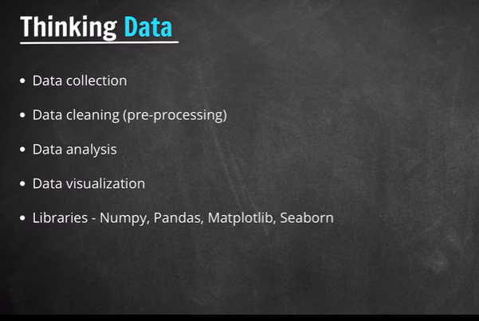

when we are talking to train ML algorithms or Deep learning . these all algothitms train with lots of data.

Data is very important . We should know deal with data and think about data as Data Scientist or a ai engineer. 

Learn more and more and practice more 

### --------  ######

### Getting Started 

we will start with jupyter lab

i am working in this data folder

data> jupyter lab

we can  work in base environment or can create new custom environment

we can see open terminal --> 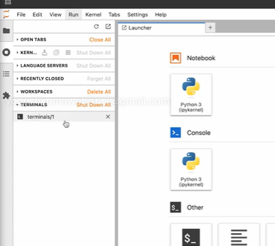

now we are learning thinking about data 
creating thinking_data.ipynb

ctrl+Enter ==> run

we can re run all cells --> 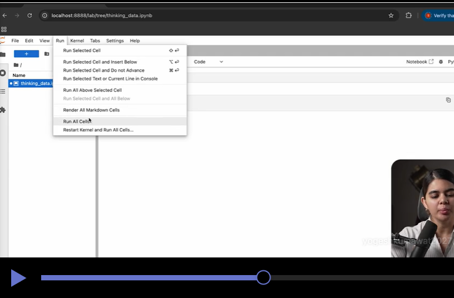

cells ke sath number denotes run

Kernel restart button also here and resterting and rerunning button also >>

Shift + Enter ==> run and create new cell

we can open this .ipynb file in vs code also . many developers working in vs code on these files

** Settings-> theme --. dark theme

###

What mean about clean and structured data and taking insites from data, useful information

# Setup Json Data
## Assignment1 - Cleaning & Structuring our data

we are  working on a amazon ecommerce data task

data about product sells, users, feedbacks and rating name of user in the form of json

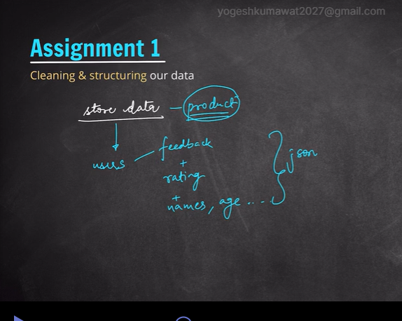

1. first we will do access and print data

Dawnload it from course -- store_data.json
 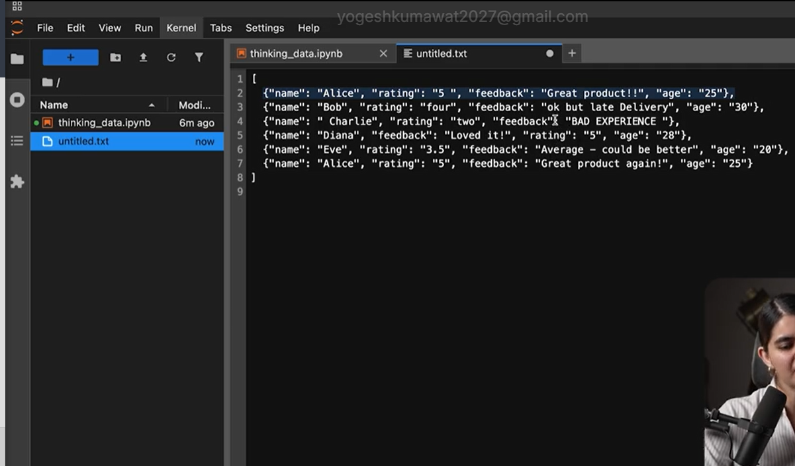

 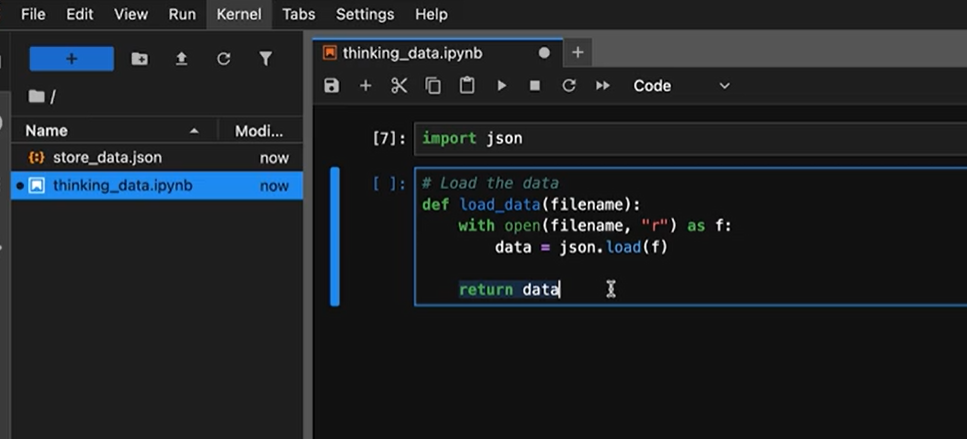
 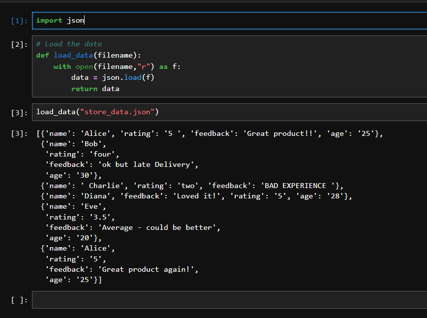

 ## now cleaning and structuring our data

 we cannot run ml algo directly without ensuring that data is clean and structured 

 see in store_data.json Alice is 2 times (duplicate data) and rating is not written in a single way .. anywhere 5 , "four" like string or int or float it is inconsistency and somewhere age missing.

 1.Data is inconsistence (rating)
 2.Missing Data (age)
 3.Duplicate Data   
        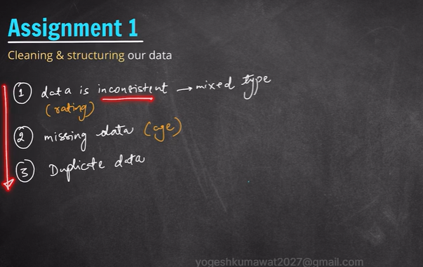

    so our data is not clean and structured

so we will make data consistent and clean

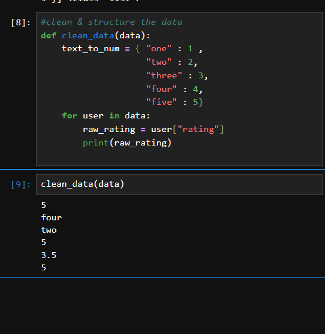

now rating update  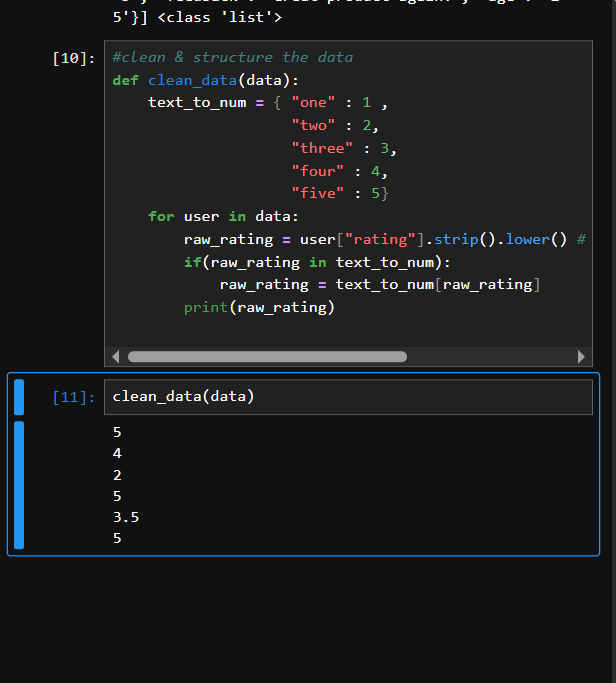

for missing data store None 

But if lots of information of entity is missing then revove that entity

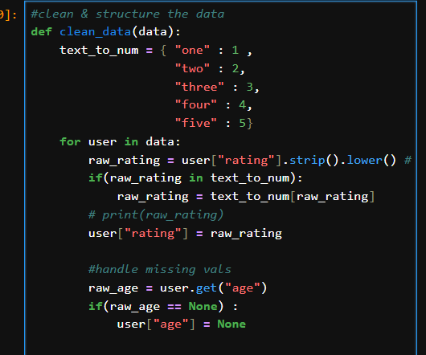

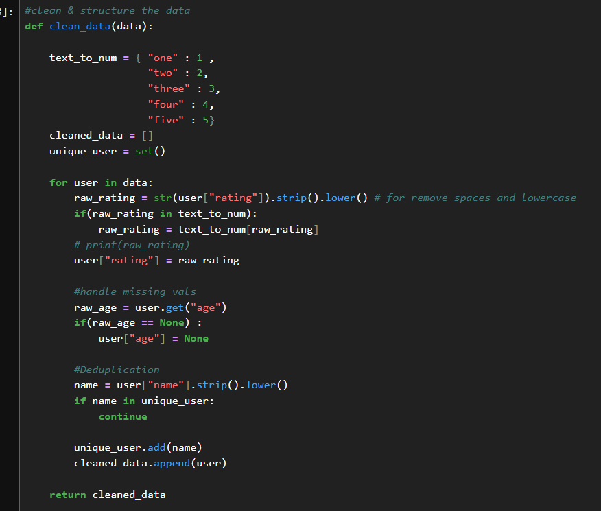

## Assignment 2
Getting meaningful insights from data

1. Whats avg rating 
2. What % of users gave poor rating(<3>)
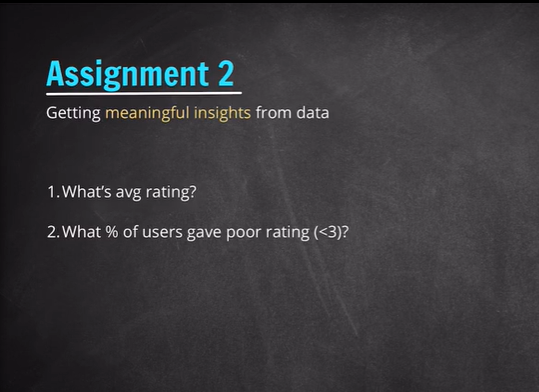

avg rating  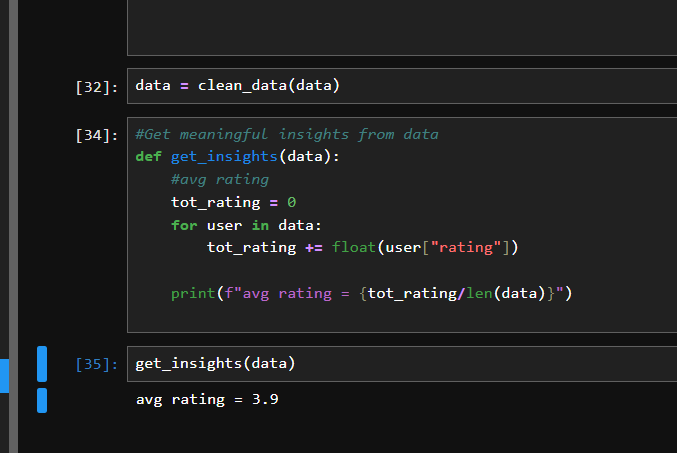

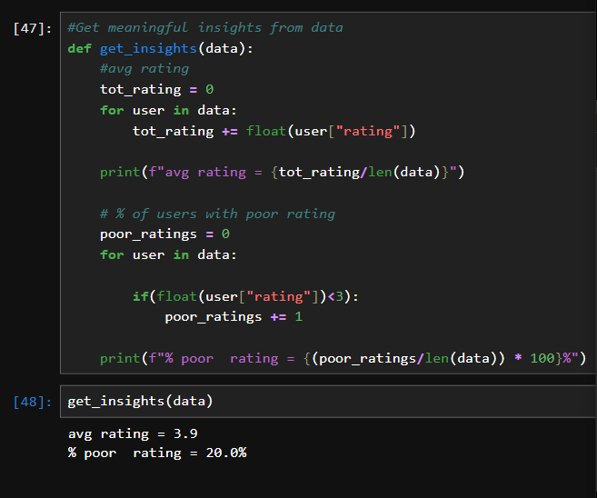

## Assignment 3    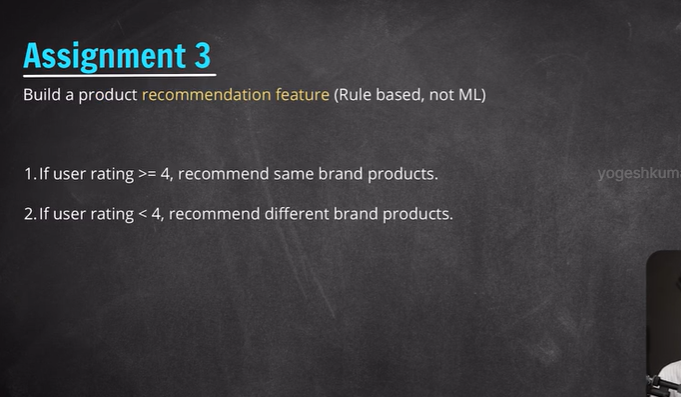

Build a product recommendation (Rule based, not ML)

1. If user rating >= 4 , reccomend same brand products
2. if user rating < 4 , recommend different brand products

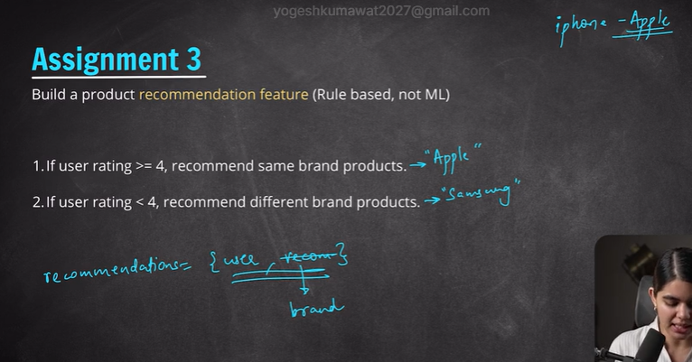

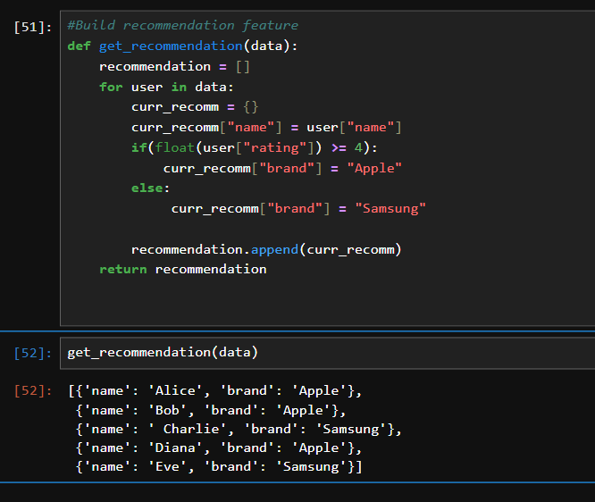