#####  NumPy - Numericsl Python

Designed for fast numerical computing

Important package for data science and machine learning.
having modules relted to math lots of functions and ND array

Go to numpy.org for documentation

nd - n dimentional array faster and efficient then python list
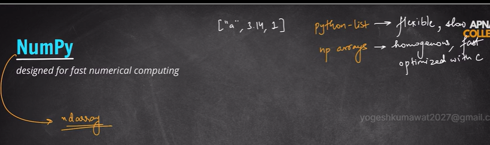

Difference b/w list and array will realize millions of data in machine learning 
speed and memory optimization

Python list can store multiple type of data but array can store homogenous data single type 

Numpy installed by default by anaconda

import numpy as np --> np is a statndard name but not necessory 

if not installed numpy --> pip install numpy

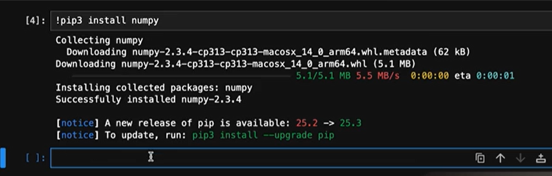

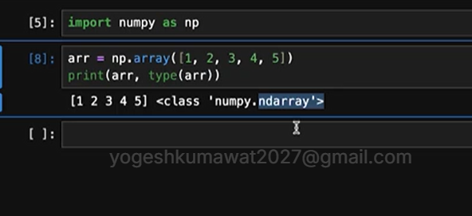

Python list V/s NumPy Array 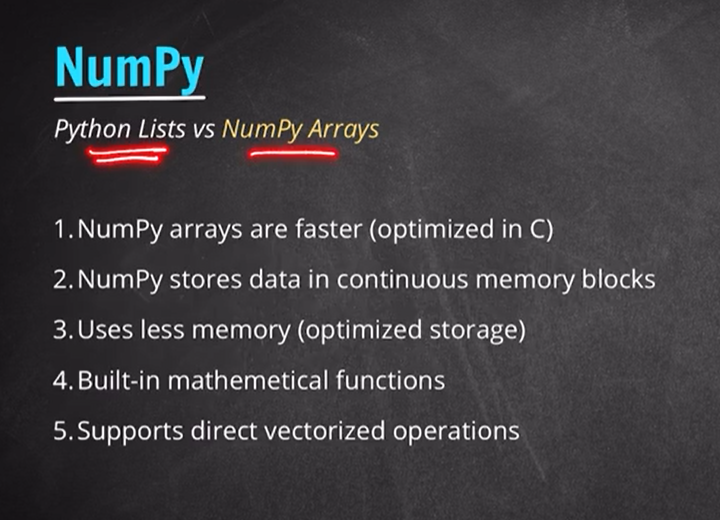

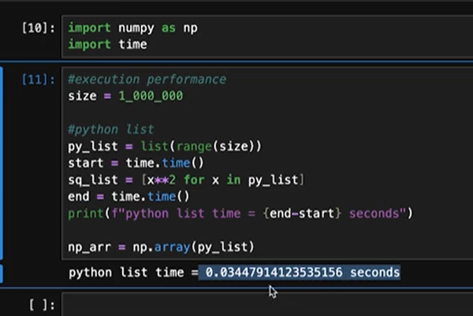  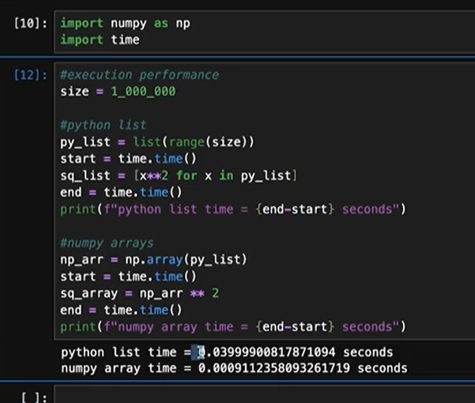

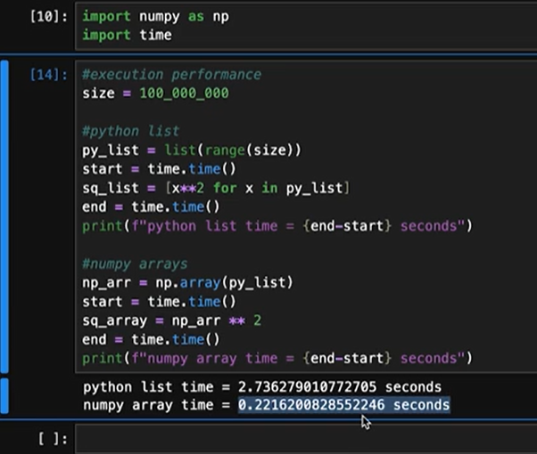  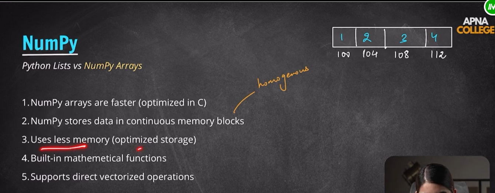

memory performance-- 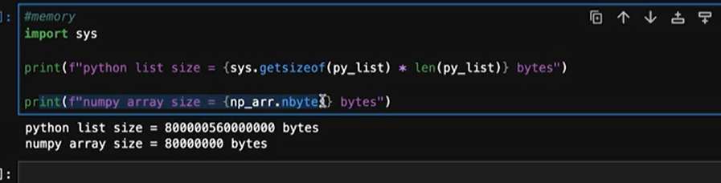

list stores metadata so its take more size 

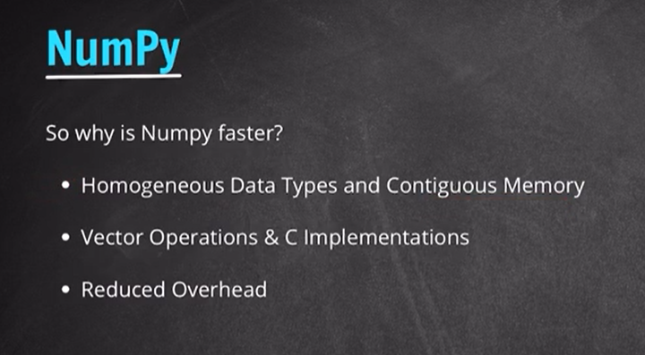

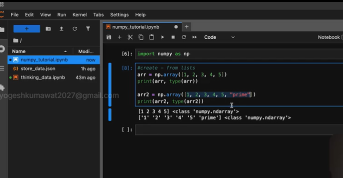  if any data is string or other type array will convert same type 

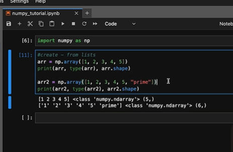 shape means - Dimension

2D- array 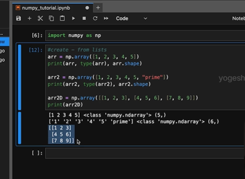 
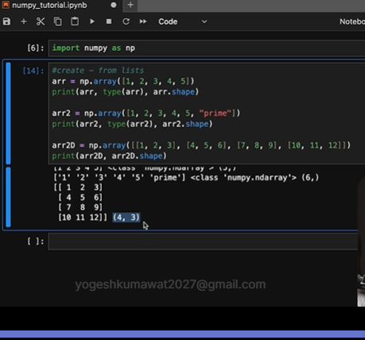

######

** Numpy Array from scratch with zeros 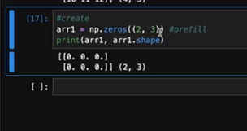

** change datatype of zeros dtype="int64"

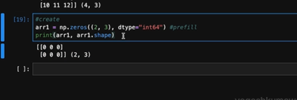

** Ones prefill array 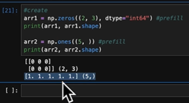

Prefill arra with value 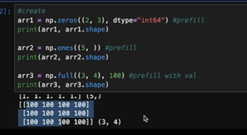

** Identity matrix - 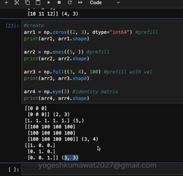

** range array - 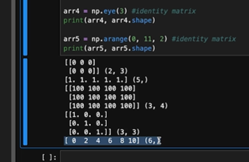

** linspace array - 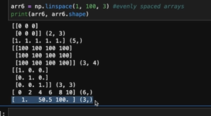

 ####  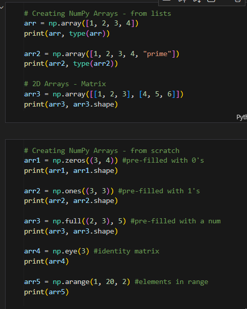

 ## Array Properties 

 1. arr.shape - print dimention(m x n) of array
 2. arr.size  - total element 
 3. arr.dtype - data type like int64
 4. arr.ndim - 2 for 2D array

5.  type casting 
 Ex : float_arr = arr.astype(np.float64)
 print(float_arr,float_arr.dtype)

 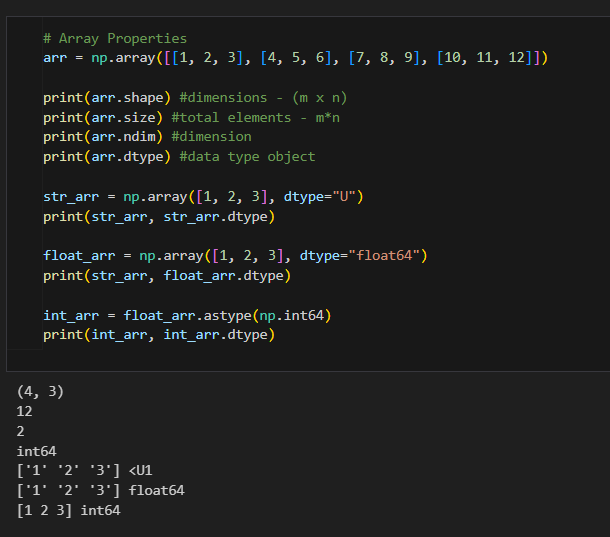

 ## Operations

## Reshaping of Array  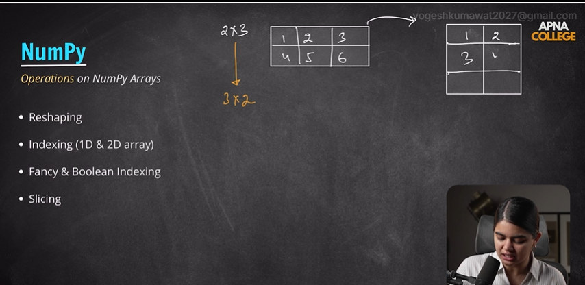

arr.reshape((3,2)) -- pass new dimensions 

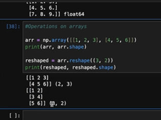 we can do it if compatable numbers like same fit element in both conditions 

2X3 ko 5X2 not possible
## flattend array - 2D to 1D
arr.flatten()     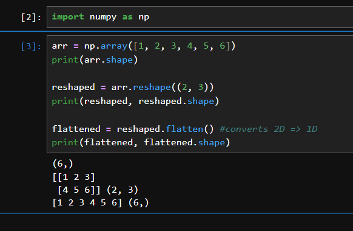

## indexing (1D & 2D array)

arr[0] - 0 index value
arr[0][2] - 2d array indexing

## fancy indexing 
[1,2,3,4,5]

idx = [0,1,3]
print(arr[idx]) --> [1 2 4]

## Boolean indexing - condition true

print(arr[arr > 2]) #nums greater than 2
[3 4 5]

## Slicing - start,end,step

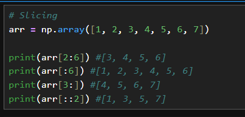

# Copy vs View in Slice 
slicing of array is similar as list
But big defference in internal slicing 

Python List Slice craetes --> Copy  (extra memory)

NumPy Array Slice --> View not copy no extra memory space
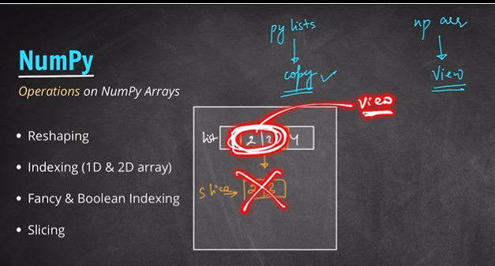
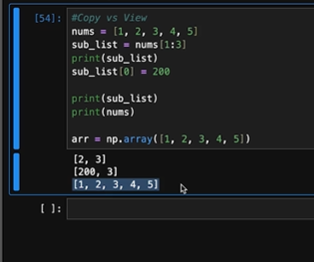
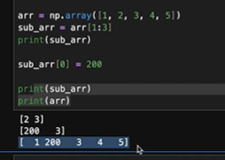 change in subarray then it will reflect in array also

We can use arr[1:3].copy() in subarray to do not change in main array. only copy of view 

   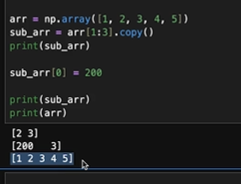

## Common Numpy Data Types

Integers : int32 , int64 , int128 , int16
Floating point nums : float32,float64
Boolean:bool
Complex nums:complex64,complex128
String : S (byte-str) & U (unicode-str)
Object : generic python objects - object

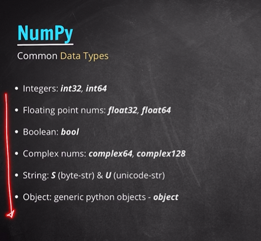
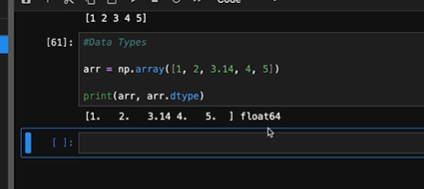

Dawncast -- we can use minimum memory datatypes like int8 is better then int64 . converting dataTypes down side called as Downcast .

like we are storing age then we can use int16 rather than int64 .

Like we are storing cell of image 0-255 then not need to store int64  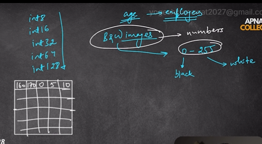

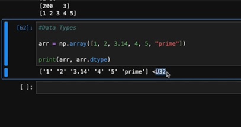

** Complex nums = real + imeginary = 2+3i
complex nums also used in algorithms of ml

64+64 => 128   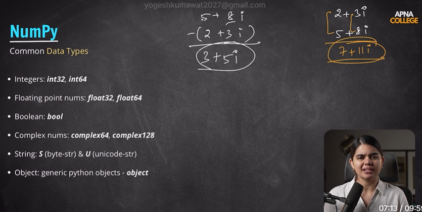

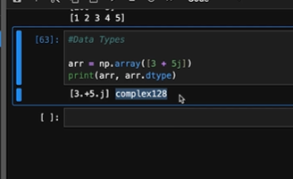
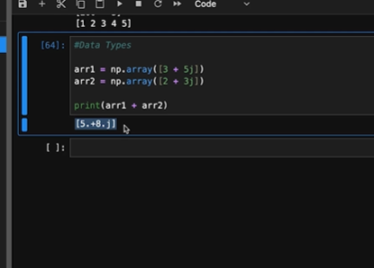

We do not prefer String and object using numpy . numpy is for numerical computation But we can create . But no any real seniores to create using numpy

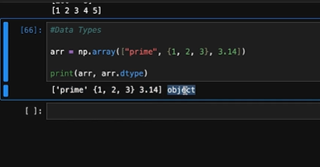 

##  Axes in Multi-dimensional arrays

Multi dimensional arrays used like 2d matrx for images 

For balck and white image 0 and 255 in cell according to image - 2D

For colored image use RGB values 3D matrix 
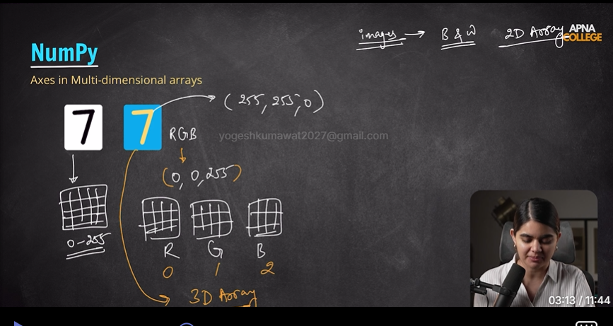

Axes - like as dimention (plural of axis)
  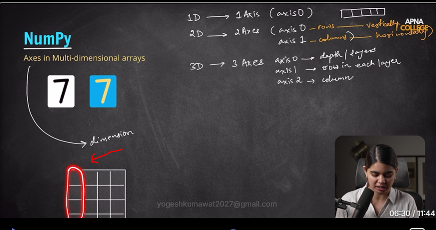

  rows - vertical operations means each index ke columns par 

  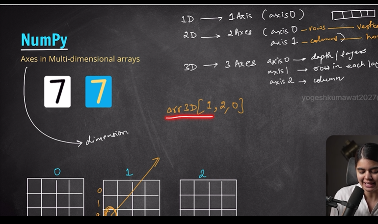

  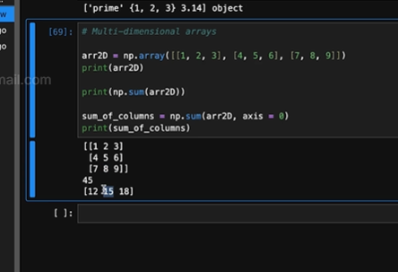

  arr2D = np.array([[1, 2, 3], [4, 5, 6], [7, 8, 9]])

print(arr2D)
print(np.sum(arr2D)) #sum of entire array

sum_of_columns = np.sum(arr2D, axis = 0)
print(sum_of_columns)

sum_of_rows = np.sum(arr2D, axis = 1)
print(sum_of_rows)

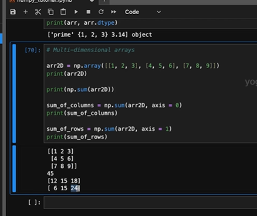
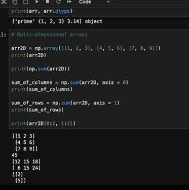

## 3D Arrays  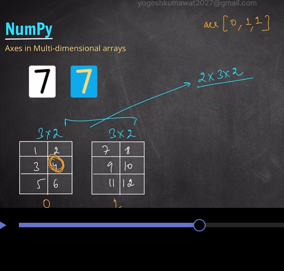

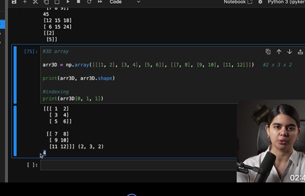

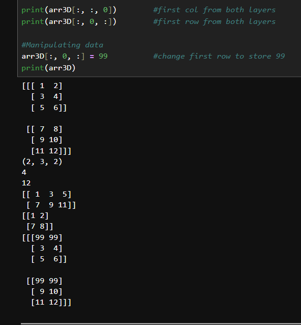

## Vectorization & Broadcasting 
in list we use loop 
but in numpy we can use vectorization
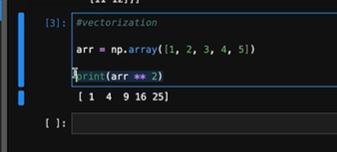  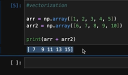

# Broadcasting -- 

Scaling -- if size is not compatable for mathmatical computation we make stretch
Ex : [1,2,3,4,5] + 5
==> [1,2,3,4,5] + [5,5,5,5,5] <-- Broadcasting 
these not take extra memory its just a concept 

Broadcasting har size ke array ke operations ke liye nahi hai
It have some rules -- read numpy docs  

## Vector normalization
Broadcasting use for Vector normalization -- mean , standard Daviation (std)

normalized-array = (array- mean)/starnd_dev  

now ab normalized array ka mean  = 0 and std_dev =1

## Mathematical functions 
