## instaling Anaconda  
  --- free and open source for programming language Python , R

  still we are using vs code for python and now we will use Anaconda and jupyter lab for data science and ml 

  in Anaconda some packages easily available like Numpy Panadas  around 300 packages

 ** for lightweight project use miniconda

 go to --> anaconda.com/dawnload 

 

 ## Conda Prompt 

 

 normally ek tool ka ek hi version use hota hai ek time par but ham ese diffrent projects me diffrent version par kaam karna chahte hai ya koi logical separation chahiye to uske liye ham multiple *** Environments ** ko create kar sakte hai . Conda help to like this-> package and event management
 

write conda in CLI
>conda

wor windows write commands at anaconda prompt99 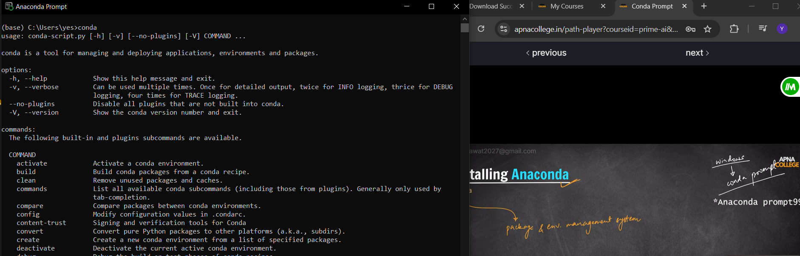

> conda activate   ---> base environment will create
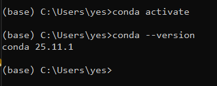

> conda list --> packages in environment

## creating new environment 
> conda create -n primeenv
then
>conda activate primeenv    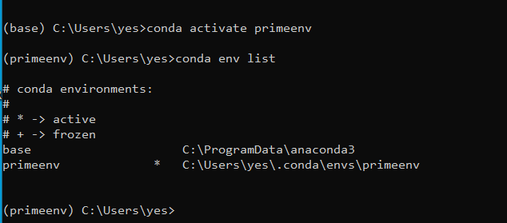

environment delete commands 
1. conda env remove -n NAME
2. conda remove -n NAME --all 
but first conda dectivate
>conda deactivate
> conda env remove -n primeenv

now in base environment 
>conda deactivate    -----> now in normal window

 for base env
 >conda activate      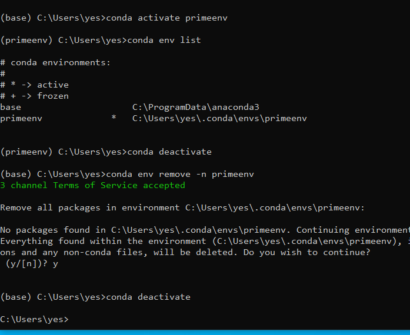

#####  Installing Jupyter Notebook

    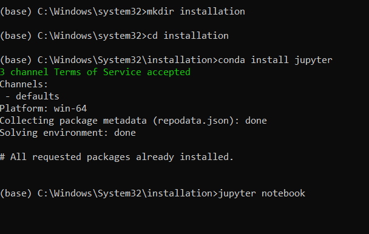

> conda install jupyter
>jupyter notebook   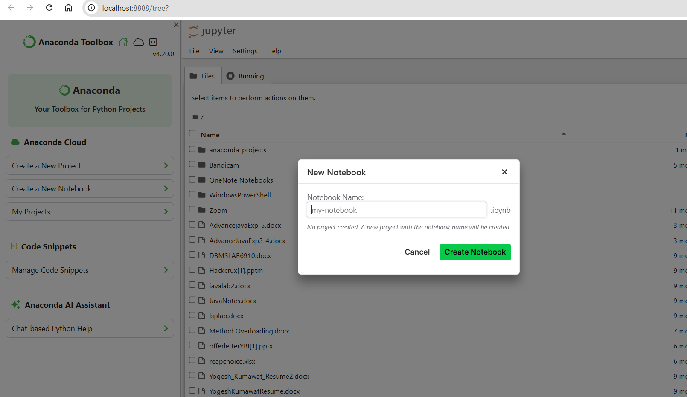
 .ipynb extension for jupyter notebook -- i python notebook

 difference between file and .ipynb is we can run block of codes or parts of code in single notenook  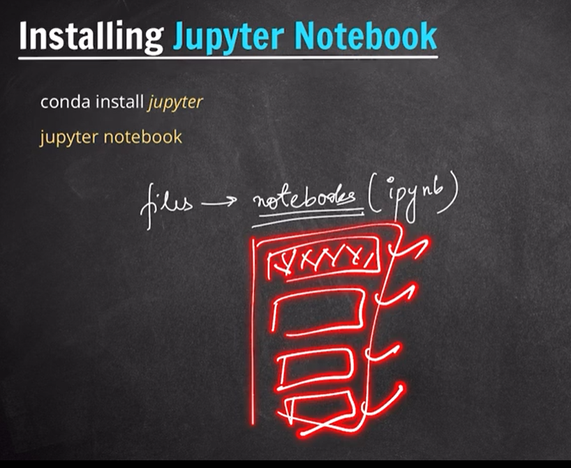

 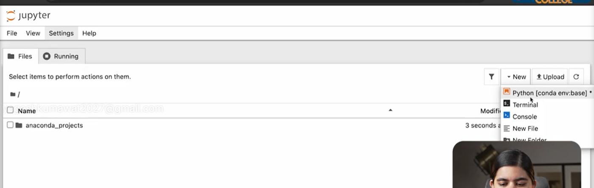

 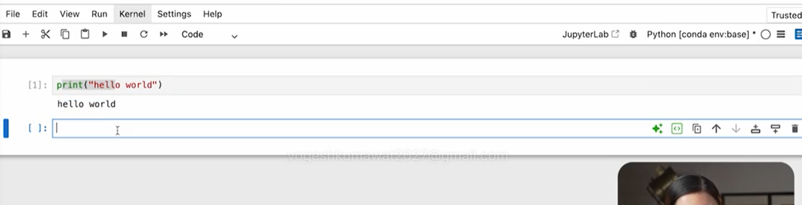

 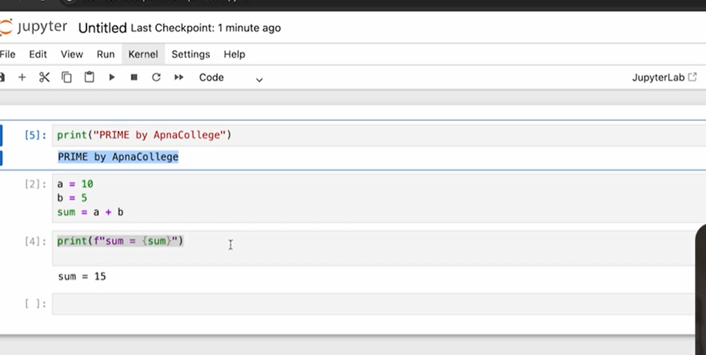 we can devide our code in chunks

 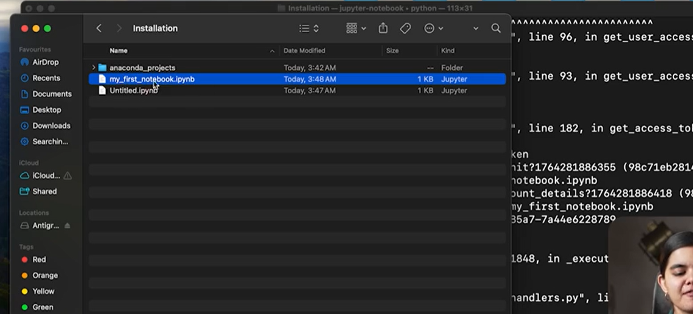

 ### Installing Jupyterlab (Advance of notebook)
 >conda install jupyterlab
 >jupyter lab
  
  its needed for different type of files in single entity

  --> we can create new folder and usi folder me terminal open kar sakte hai. and we can open python notebooks

  **** markdown --> text with code in notebook 
    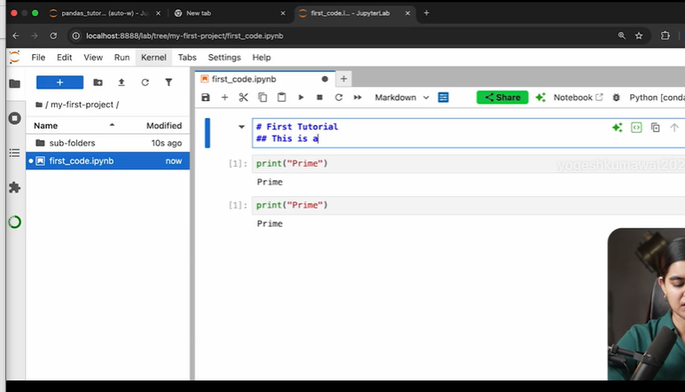

    we can restart Kernel and clear outputs of all cells  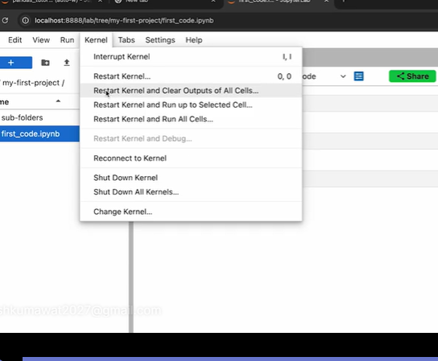